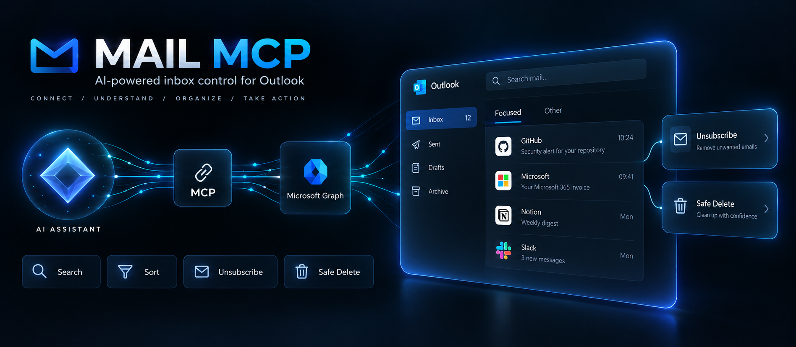
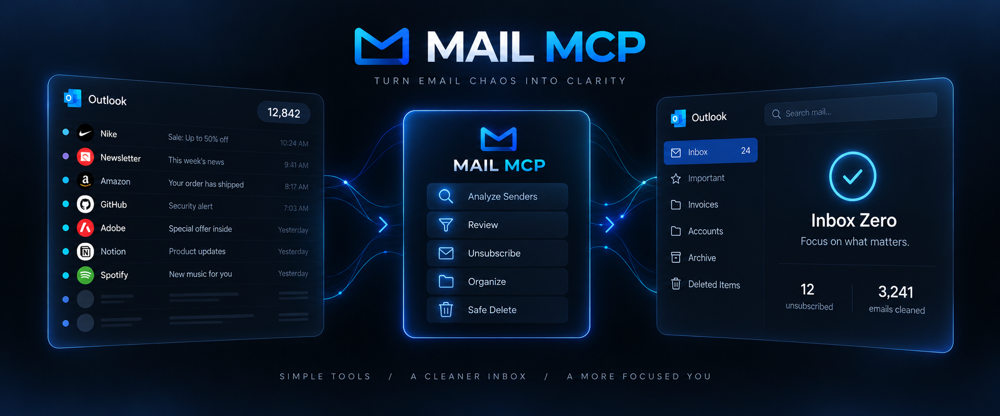

# Mail-MCP

[](https://github.com/Rixtayz/Mail-MCP/actions/workflows/ci.yml)
[](https://www.npmjs.com/package/@rixtay/mail-mcp)
[](package.json)
[](LICENSE)
[](https://registry.modelcontextprotocol.io/v0/servers?search=io.github.Rixtayz/mail-mcp)



A small, focused [MCP](https://modelcontextprotocol.io) server that lets Claude (Claude Desktop, Cowork, Claude Code or any MCP client) work on a **personal Outlook mailbox** (Outlook.com, Hotmail, Live or MSN address) through Microsoft Graph: read and search mail, file it into folders, delete it, and **unsubscribe from newsletters**. You install it, say "connect my Outlook", sign in with Microsoft in your browser, and that is all: no app registration, no terminal, no config file.

Built for one job: clean up an overflowing personal inbox with an AI assistant, safely.

## Tools

Eleven tools, all prefixed `mail_`:

| Tool | What it does |
|---|---|
| `mail_login` | Sign in through the browser (the assistant calls it when you are not signed in) |
| `mail_logout` | Sign out and remove the sign-in stored on your computer |
| `mail_list_folders` | Folder tree with total / unread counts |
| `mail_create_folder` | Create a folder (idempotent) |
| `mail_search` | List / search messages (sender, date range, unread, full text), paginated |
| `mail_get_message` | Full content of one message + detected unsubscribe options |
| `mail_senders_summary` | **Aggregate a whole folder by sender**: volume, latest message, available unsubscribe method |
| `mail_move` | Move up to 500 messages to a folder |
| `mail_delete` | Move to Deleted Items by default, `permanent: true` to purge |
| `mail_bulk_by_sender` | Move or delete every message from one sender (`dryRun` supported) |
| `mail_unsubscribe` | RFC 8058 one-click POST, otherwise a link for the browser, otherwise a ready `mailto:` link you send from your own mail app |

Design choices:

- **Mail-MCP cannot send email.** It does not ask Microsoft for the permission to send, and no tool sends a message. Even `mail_unsubscribe` only hands you a link when a sender wants an email.
- **Safe by default.** Deletion goes to Deleted Items (visible and restorable in Outlook). Permanent deletion requires an explicit flag. Bulk actions support `dryRun`.
- **Efficient on big mailboxes.** `mail_senders_summary` scans thousands of messages in a few seconds (1,000-item pages, minimal `$select`) and only fetches headers for the top senders through `$batch`.
- Every tool ships a strict input schema, an output schema and MCP annotations (`readOnlyHint`, `destructiveHint`, …) so hosts can auto-approve read-only calls.



## Quick start: Claude Desktop

You need a personal Microsoft account (outlook.com, hotmail.com, live.com, msn.com). Work or school accounts are not supported.

1. Download `mail-mcp-<version>.mcpb` from the [latest release](https://github.com/Rixtayz/Mail-MCP/releases/latest).
2. Double-click it and install the extension in Claude Desktop.
3. Tell Claude: "connect my Outlook". Your browser opens on a Microsoft sign-in page. Choose your account and accept.

## Claude Code

Node.js 22 or newer is required.

```bash
claude mcp add --scope user --transport stdio mail -- npx -y @rixtay/mail-mcp
```

Then ask Claude to connect your Outlook. If you prefer a terminal, `npx -y @rixtay/mail-mcp login` does the same sign-in.

## Other MCP clients

Node.js 22 or newer is required. Add this to the client's MCP configuration (for Claude Desktop without the extension, that is `claude_desktop_config.json`, reachable through Settings, Developer, Edit Config):

```json
{
  "mcpServers": {
    "mail": {
      "command": "npx",
      "args": ["-y", "@rixtay/mail-mcp"]
    }
  }
}
```

If the client cannot find `npx` (some do not inherit your shell `PATH`), use absolute paths instead: `"command": "/absolute/path/to/node"`, `"args": ["/absolute/path/to/Mail-MCP/dist/index.js"]` from a clone.

## Security and privacy

The short version: the software runs on your computer and talks to Microsoft. Its author runs no server and receives no data. The full text is in [PRIVACY.md](PRIVACY.md) and [TERMS.md](TERMS.md).

**No server, no telemetry.** Mail-MCP has no analytics, no update check and no service operated by its author. The publisher never sees your mail or your tokens: the tokens stay on your machine.

**Hosts it contacts.** These, and no other remote host:

- `login.microsoftonline.com`, to sign you in.
- `graph.microsoft.com`, to read and organize your mail.
- The unsubscribe address a sender published in its own email, only when you ask to unsubscribe and the sender supports RFC 8058 one-click. The server refuses to send that request to a private, loopback or link-local address.

During a sign-in it also listens on 127.0.0.1, on your own computer, where your browser hands back Microsoft's answer.

**What the Microsoft consent screen asks, and why.** The only Microsoft Graph permission requested is `Mail.ReadWrite`. At first sign-in Microsoft shows three lines, summarized here:

1. Reading and writing your mail. Needed to list, read, move and delete messages. Microsoft adds that this does not include permission to send email, and it does not: Mail-MCP does not request `Mail.Send`.
2. Your basic profile. Part of signing in, so the app knows which account signed in. Mail-MCP does not call the profile endpoint.
3. Keeping access to data you have given it access to. Lets the sign-in refresh without asking you again every hour.

**Where the sign-in is stored.** In `~/.mail-mcp/token-cache.json` (or the path in `MAIL_MCP_CACHE_PATH`), written so that only your user can read and write it (mode 600). On Windows the operating system does not enforce that mode, so the file is protected only by the permissions of your user folder. Tokens are not kept in the system keychain. They never appear in a tool result.

**Signing out and revoking.** Ask Claude to sign you out (`mail_logout`) or run `npx -y @rixtay/mail-mcp logout`: both delete the file above. To also withdraw the app's access on Microsoft's side, open <https://microsoft.com/consent> and remove Mail-MCP.

**Where the code comes from.** Releases are published from GitHub Actions, not from a personal machine, with [npm provenance](https://docs.npmjs.com/generating-provenance-statements). The package page on npmjs.com shows the commit and workflow run a version was built from, and `npm audit signatures` checks the signatures and provenance of installed packages. Each GitHub release also carries the `.mcpb` file. This applies to releases from 0.2.0 on.

From 0.3.0 on, the release workflow builds and tests a commit already on `main` once, then publishes those exact files, and the `.mcpb` carries a GitHub build attestation. To check that a `.mcpb` you downloaded was built by this repository's release workflow, run, with the [GitHub CLI](https://cli.github.com):

```bash
gh attestation verify mail-mcp-X.Y.Z.mcpb -R Rixtayz/Mail-MCP
```

GitHub releases are immutable from 0.3.0 on: once a release is published, its files and its tag cannot be changed or replaced.

**Verified publisher.** The consent screen names the publisher, Les Solutions Devforge inc, with Microsoft's verified badge. That means Microsoft has confirmed, through its partner program, which company registered the app; Mail-MCP itself is published by Rixtayz. It does not mean Microsoft reviewed the code: the code is in this repository. If you would rather not rely on the shared app, use your own, below.

## Use your own Entra app (advanced)

Optional: Mail-MCP works without it. Do this if you want the app registration to be yours. It is free and needs no Azure subscription.

1. Go to <https://entra.microsoft.com> and open **Identity, Applications, App registrations, New registration**.
2. **Name**: `Mail-MCP` (any name).
3. **Supported account types**: **Personal Microsoft accounts only**.
4. **Redirect URI**: platform **Mobile and desktop applications**, value `http://localhost`.

Register, copy the **Application (client) ID**, then set it before starting the server.

bash:

```bash
export MAIL_MCP_CLIENT_ID=<id>
```

PowerShell:

```powershell
$env:MAIL_MCP_CLIENT_ID = "<id>"
```

For Claude Code, add the server with this command instead of the one above (`--env` takes several values, so keep another option between it and the server name):

```bash
claude mcp add --scope user --env MAIL_MCP_CLIENT_ID=<id> --transport stdio mail -- npx -y @rixtay/mail-mcp
```

For the Claude Desktop extension, fill in "Your own Entra client ID" in its settings. For a JSON configuration, add `"env": { "MAIL_MCP_CLIENT_ID": "<id>" }` to the server entry. No client secret exists: the server is a public client using the authorization code flow with PKCE.

| Environment variable | Purpose |
|---|---|
| `MAIL_MCP_CLIENT_ID` | Optional. Client ID of your own Entra app. Unset or empty: the built-in app |
| `MAIL_MCP_CACHE_PATH` | Optional. Token cache location |

## Upgrading from 0.1.x

Nothing to do: an existing sign-in and your own `MAIL_MCP_CLIENT_ID` keep working.

Version 0.1.x asked Microsoft for the permission to send mail, which 0.2.0 neither uses nor requests. Your earlier consent may still include it on Microsoft's side. To remove it, sign out (`mail_logout`), remove the app at <https://microsoft.com/consent>, then sign in again.

One behaviour changed: when a sender accepts unsubscribe requests only by email, 0.1.x sent that email itself. 0.2.0 returns a `mailto:` link instead and you send it from your own mail app, because the recipient and text come from the sender, not from you.

## Example prompts

- "Connect my Outlook."
- "Summarise the senders in my inbox and flag the newsletters."
- "Unsubscribe me from every newsletter I haven't opened in six months, then move their messages to Deleted Items."
- "Create an Invoices folder and move everything from billing@vendor.com into it."
- "Show me the latest email from my bank."

Typical flow: `mail_senders_summary` → the assistant proposes a list, you confirm → `mail_unsubscribe(lastMessageId)` per newsletter (when the answer is `method: "browser"`, the assistant opens the URL in its browser and finishes there; when it is `method: "mailto"`, you open the link and press Send) → `mail_bulk_by_sender(action: "delete")`.

## Development

```bash
npm test            # vitest: header parsing, Graph retry/batch/pagination, service with a mocked Graph
npm run typecheck
npm run inspect     # MCP Inspector against dist/index.js
npm run build:mcpb  # build the Claude Desktop extension locally
```

Layout:

```
src/index.ts          CLI entry point: `mail-mcp` serves stdio, `login` and `logout` manage the sign-in
src/login.ts          interactive sign-in flow
src/session.ts        sign-in driven by the assistant: one browser sign-in at a time
src/server.ts         builds the McpServer and registers the tools
src/auth.ts           MSAL public client, file-based token cache
src/graph.ts          Graph client: bearer auth, 429/503 retry, pagination, $batch in chunks of 20
src/mail.ts           business logic (folders, search, sender summary, move/delete, unsubscribe cascade)
src/unsubscribe.ts    List-Unsubscribe / List-Unsubscribe-Post parsing, RFC 8058 one-click POST, mailto: link
src/tools/*.ts        tool definitions (zod v4 schemas, annotations)
```

Stack: `@modelcontextprotocol/server` v2, zod v4, `@azure/msal-node` v7, `html-to-text`.

## Things worth knowing

- **Message ids change** whenever a message changes folder. `mail_move` and `mail_delete` return the old → new id mapping.
- A normal delete is a **move to Deleted Items**. Graph's own `DELETE` would drop the item into Recoverable Items, which is invisible in Outlook, so it is deliberately not used.
- Microsoft throttles Outlook to 10,000 requests per 10 minutes per mailbox and 4 concurrent requests. Batches are serialised and retried on 429.
- `mail_search` with `query` (full text) cannot be combined with the other filters (Graph limitation) and tops out at a few hundred results.
- Whether an unsubscribe actually takes effect is up to the sender. One-click sends the request itself; for the other methods the assistant's browser or your mail app finishes the job.
- The `mailto:` link keeps only the address, subject and body the sender published (the subject is cut at 200 characters and the body at 1,000), and only when the address is a single plain address.
- The authority is `login.microsoftonline.com/consumers`. With `common`, refresh tokens for personal accounts are rejected after the first refresh.

## Contributing

Bug reports, fixes and focused new tools are welcome: see [CONTRIBUTING.md](CONTRIBUTING.md). Please never paste real email content, addresses or tokens in an issue. Found a way the server could leak mail or tokens, or act without being asked? Please report it privately, as described in [SECURITY.md](SECURITY.md).

Release history: [CHANGELOG.md](CHANGELOG.md).

## License

MIT. See also [PRIVACY.md](PRIVACY.md) and [TERMS.md](TERMS.md).
